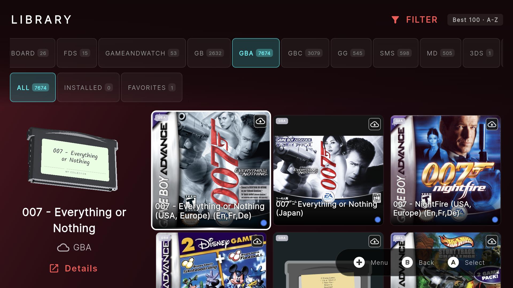
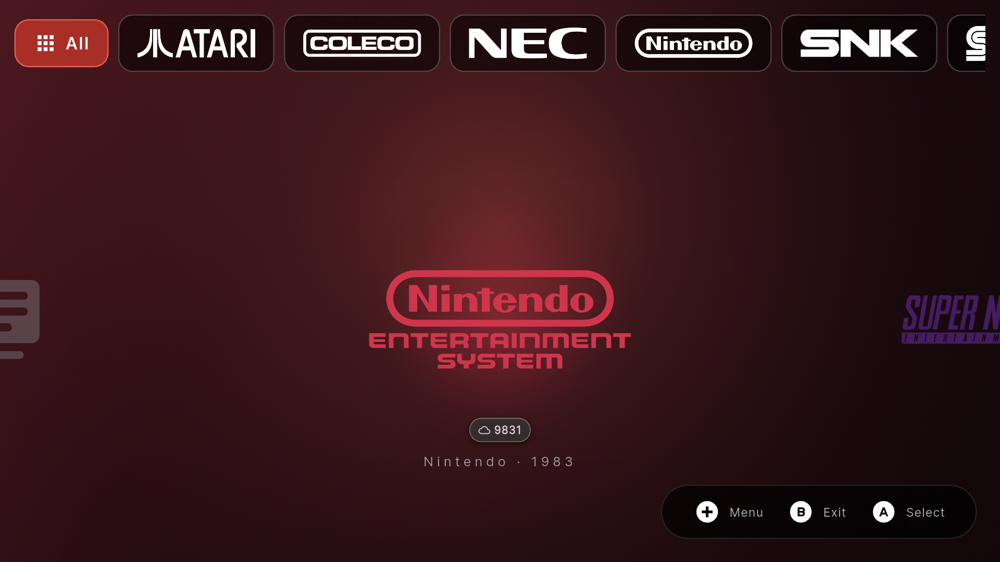
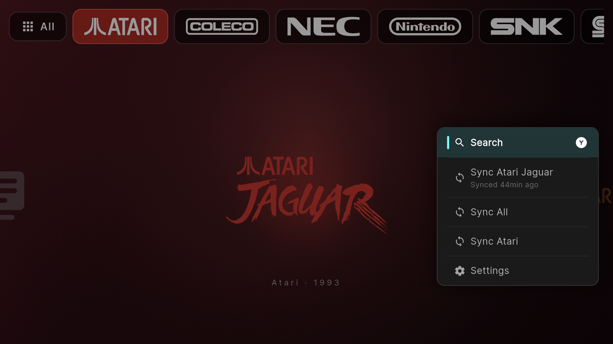
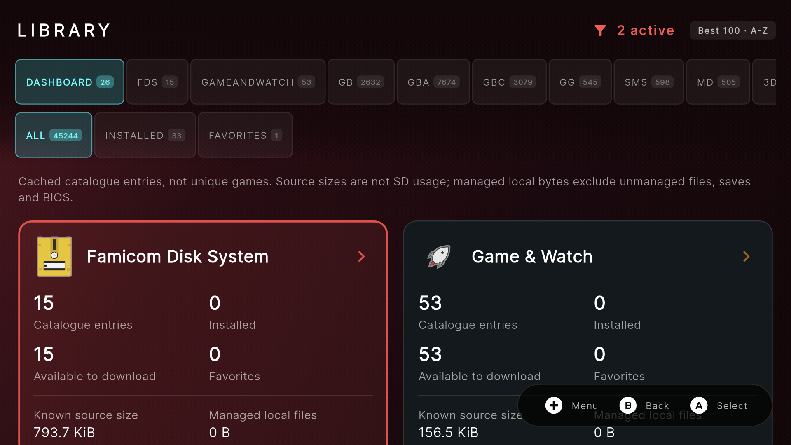
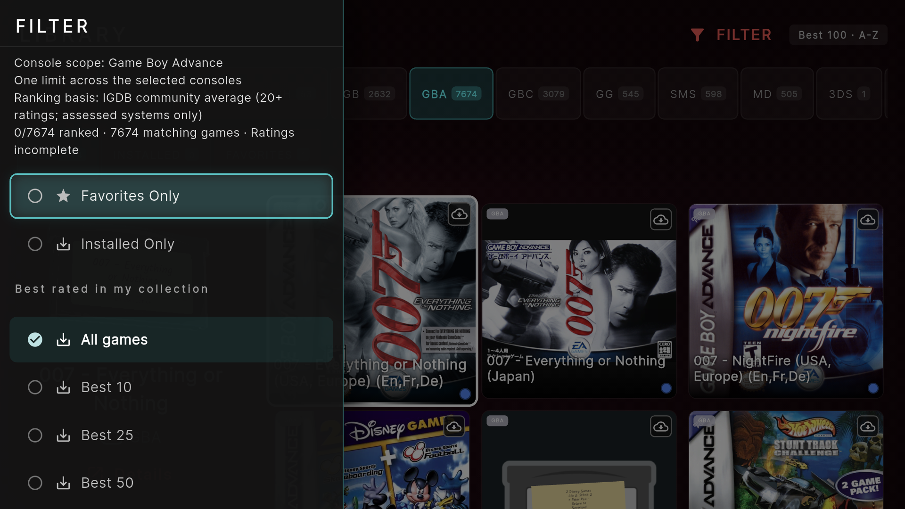
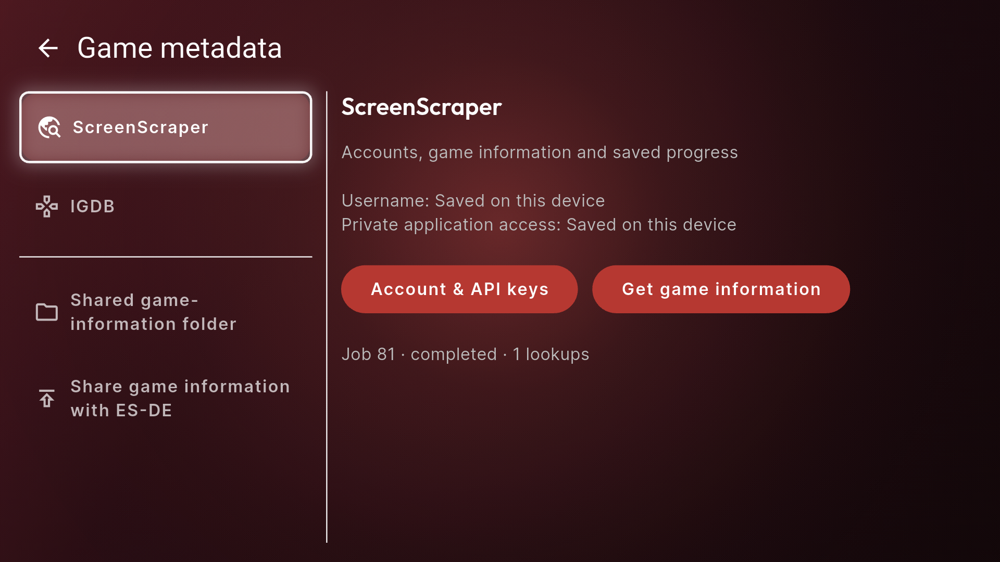
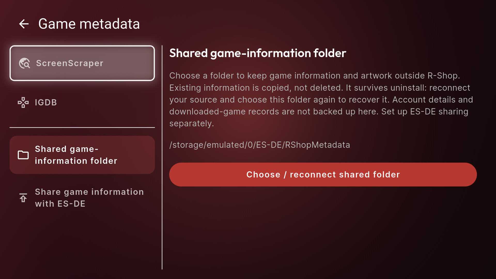
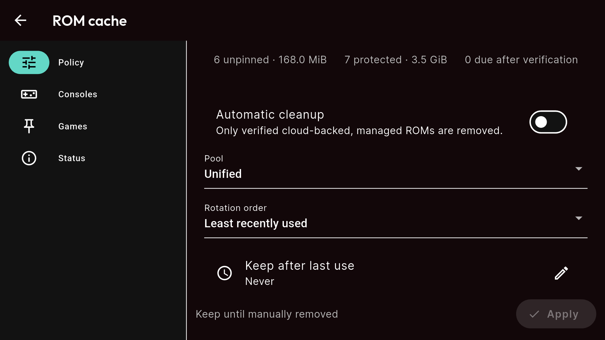
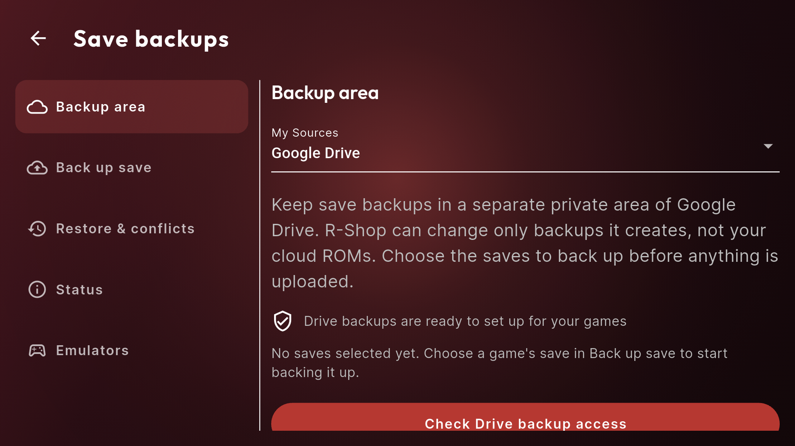

# R-Shop — cloud library, handheld first

A fork of [AverageConsumer/R-Shop](https://github.com/AverageConsumer/R-Shop) for keeping a large retro collection in Google Drive and downloading games when you want to play. Keep the controller-first frontend, add richer discovery, and spend your SD space on the games you actually use.

[Download the latest APK](https://github.com/Darkaxt/R-Shop/releases/latest) · [Add to Obtainium / ObtainX](https://apps.obtainium.imranr.dev/redirect.html?r=obtainium://add/https://github.com/Darkaxt/R-Shop) · [Upstream project](https://github.com/AverageConsumer/R-Shop)

Production package: `com.darkaxt.rshop` · APK: `app-release.apk` · Android 7.0+ · Current release: **1.9.1**

  

*Real Thor capture running the published production APK. The preview uses resources imported locally from the owner's original Socket APK; those resources are not bundled with R-Shop.*

## What changes from the original?

The original R-Shop provides the controller-first foundation: local libraries, RomM pairing, SMB/FTP/Web sources, downloads, favorites and RetroAchievements. This fork builds on that work rather than replacing it.

| Area | Original workflow | Added in this fork |
| --- | --- | --- |
| Game sources | Local folders, RomM, SMB, FTP and Web | Native Google Drive sign-in and private, read-only ROM folders; download on demand without mirroring the SD card |
| Library browsing | Library-wide grid, Installed, Favorites and search | Console tabs and a dashboard with catalogue, installed/downloadable counts and storage information |
| Console navigation | Console carousel or grid | Transparent manufacturer logos, brand filtering and **Sync manufacturer** |
| Game information | Automatic artwork and metadata | Independent ScreenScraper/IGDB gathering, source-attributed ratings, cover overlays and reviewable matching |
| Discovery | Browse/search the collection | Dynamic Best 10/25/50/100 filters and independent Hack, T-Eng, Dub, Undub and Uncensor tags |
| Artwork storage | Existing cover/metadata workflow | Reconnectable shared metadata/artwork folder and optional ES-DE publication |
| Local storage | Download games for local use | Configurable retention, rotation and budgets, unified or per-console; pins and protected games |
| Saves and related files | Emulator-managed files | Opt-in Drive backups, restore/conflict handling, queued offline changes and configurable monitored save locations |
| Physical media | Flat cover presentation | Format-specific flat fallbacks, handwritten missing-art labels, optional imported 3D media and box-to-cartridge focus animation |
| Dual-screen play | Normal game launching | Per-ROM companion selection: emulator above, linked Android app below on supported devices |
| Sync feedback | Overall progress | Second current-console progress card with real game counts once the inventory is known |

Comparison baseline: upstream's [README](https://github.com/AverageConsumer/R-Shop/blob/d615f87277617cbf3a12a6445b3c71d42cf72539/README.md) and [source types](https://github.com/AverageConsumer/R-Shop/blob/d615f87277617cbf3a12a6445b3c71d42cf72539/lib/models/config/source.dart), reviewed on 2026-10-15. The upstream column summarizes that baseline, not an exhaustive claim about every upstream capability or future release.

## A tour on AYN Thor

Unaltered 1920 × 1080 captures from the Thor's upper display, running **1.9.1/code 15**. Counts and artwork reflect this collection, not bundled content or complete metadata coverage. Open an image to inspect the full-size view.

### Browse by manufacturer, sync only that brand

Choose Nintendo, Sony, Sega, Atari or another represented manufacturer. **All** restores the full console list; **Sync Atari**, for example, refreshes that brand's configured consoles without changing source mappings.

  
  

### A dashboard instead of an endless All Games wall

See the collection, what is installed and what can be downloaded, then enter one console. Source-library size is distinct from managed local storage; unknown sizes are not invented.

  

### Find the best-rated games in your own collection

Best 25 means up to 25 qualifying games in the selected collection/console scope, not a downloaded Top list. Rankings use the accepted overall-score policy; insufficient coverage is shown explicitly. Unrated games receive no fabricated scores, and a hack does not inherit the original game's rating. Default featured order places up to the best 100 first, followed by the rest alphabetically.

  

The example intentionally shows incomplete GBA rating coverage. Gather metadata to populate ratings and overlays; this demonstrates the controls, not a completed collection-wide scrape.

### Metadata settings with real sections

ScreenScraper, IGDB, shared storage and ES-DE sharing have separate navigation sections. Keep gathered information and artwork outside the app so they can be reconnected after reinstall; this does not back up account credentials or downloaded-game ownership records.

  
  

### Keep storage and save backups under your control

Configure cache retention and rotation globally or by console. Automatic cleanup is opt-in and applies to verified cloud-backed, managed ROMs—not arbitrary folders, saves or BIOS. Save backups use a separate private Drive area, preserve conflicts and queue offline changes for later synchronization.

  
  

The cache image shows the owner's current policy, not a requirement to enable deletion. Save monitoring requires the appropriate folder grant or configured root-access path; it is not whole-device synchronization.

## Install and set up

1. Get `app-release.apk` from this fork's [latest release](https://github.com/Darkaxt/R-Shop/releases/latest), or track `https://github.com/Darkaxt/R-Shop` in Obtainium/ObtainX.
2. Add your sources in **Settings → My Sources**. Existing local, RomM, SMB, FTP and Web workflows remain available.
3. For Drive, authorize your account and select/map your own folders. Google OAuth application registration is required; the maintainer's private testing registration is not unrestricted public access. See [setup notes](docs/DEVELOPMENT_SETUP.md) when configuring your own clients.
4. Configure ScreenScraper/IGDB in **Settings → Game metadata** for fresh metadata and ratings. ScreenScraper needs user and authorized application credentials; IGDB needs application credentials. They are not included in the APK. Gathering metadata is separate from refreshing the game catalogue.
5. Optionally connect shared metadata/ES-DE folders, set cache policy, select save locations and link per-game companions. Root supports emulator-private locations where ordinary access is insufficient; basic library browsing does not require root.
6. Flat media previews are the default. Optionally import your own supported original **Socket Launcher 0.7 APK** in **Settings → Media previews**, then explicitly enable 3D. Missing/loading artwork and reduced motion skip the box reveal.

Updates retain `com.darkaxt.rshop` and its production signing identity. This differs from upstream's package, so installing alongside upstream does not automatically migrate upstream's app-private data. Release assets include checksums and source/build provenance.

## What is—and is not—synced

- Drive ROM sources are read-only. R-Shop does not upload ROMs or mirror the SD card into Drive.
- Games download before launch; this is not ROM streaming.
- Save/companion backups are separately configured, opt-in writes. Late uploads recheck remote conflicts instead of blindly overwriting another device.
- Removing a managed local game does not remove its cloud ROM. Cache cleanup does not authorize deleting unrelated files.
- Scores, artwork, BIOS, ROMs, provider credentials and Socket resources are not bundled.

## Upstream heritage and documentation

Thanks to [AverageConsumer and upstream contributors](https://github.com/AverageConsumer/R-Shop) for the original frontend, controller navigation, source integrations, queue, achievements and artwork foundation. Existing upstream screenshots remain in `screenshots/`; the gallery above is specifically this fork on Thor.

[Specification](docs/SPECIFICATION.md) · [Plan](docs/IMPLEMENTATION_PLAN.md) · [Verified status](docs/IMPLEMENTATION_STATUS.md) · [Development setup](docs/DEVELOPMENT_SETUP.md) · [Upstream user guide](docs/USER_GUIDE.md) · [Contributing](CONTRIBUTING.md)

R-Shop manages content you own or may legally access; it does not host or distribute games. Game artwork and brand marks belong to their respective owners. Included third-party notices remain applicable. Imported Socket resources remain local and are not redistributed in source or APK releases.

## License

[MIT](LICENSE), with third-party notices applying to their respective assets and dependencies.
