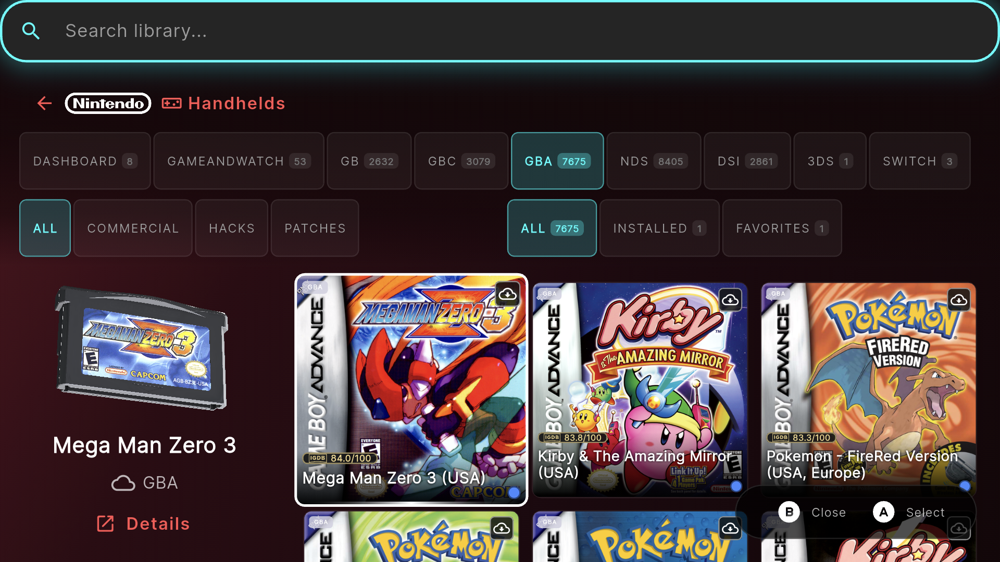
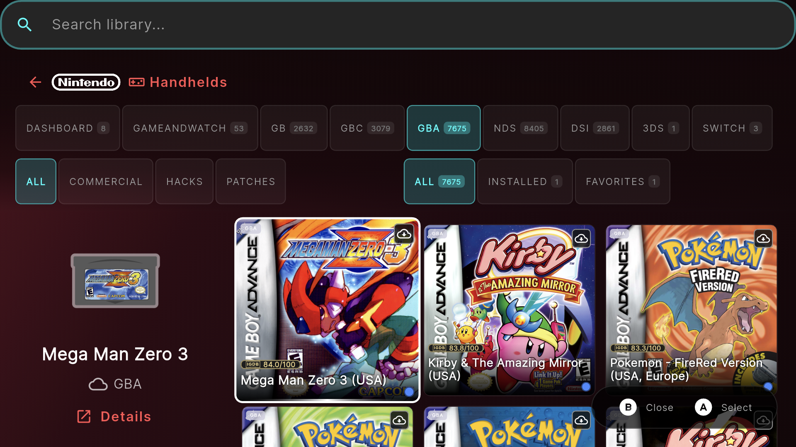
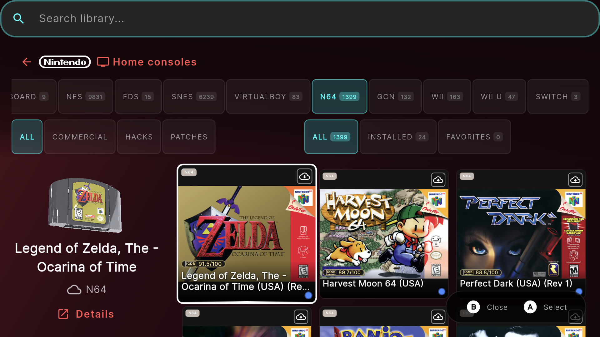
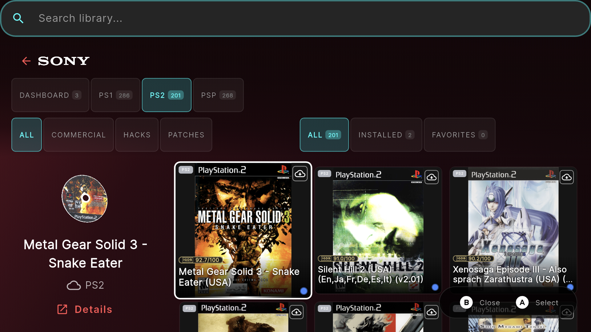
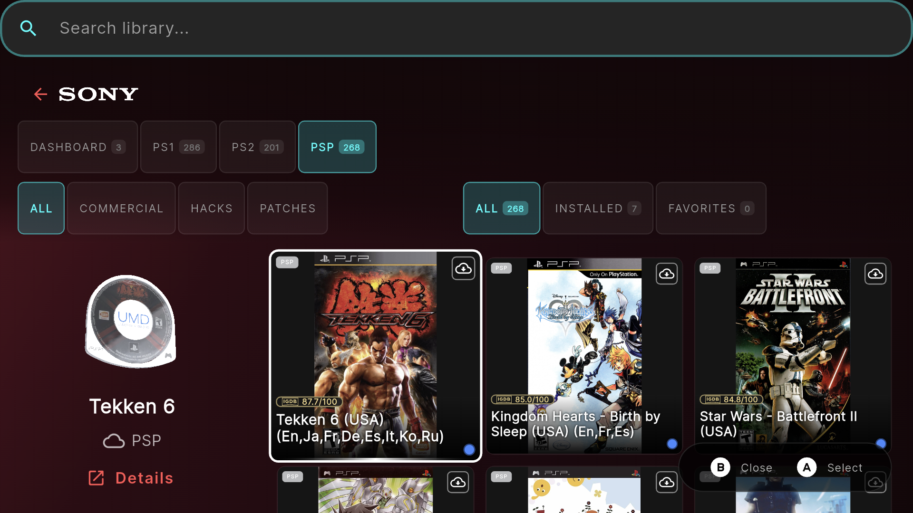
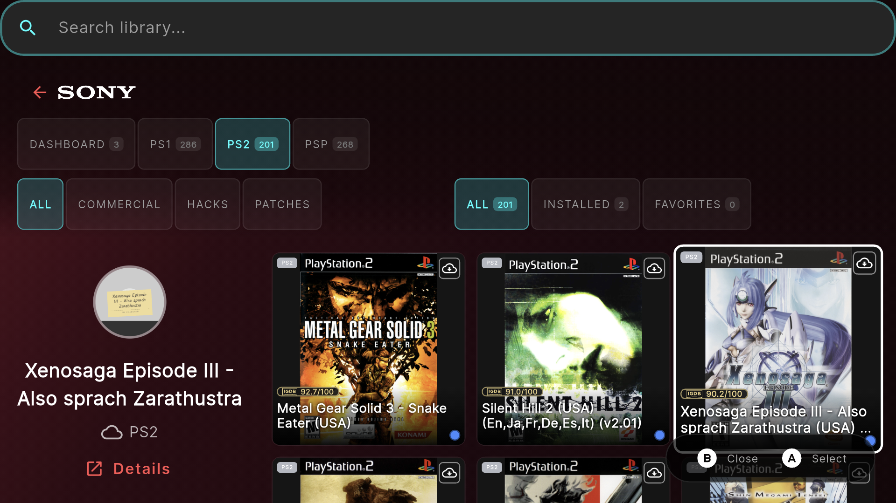
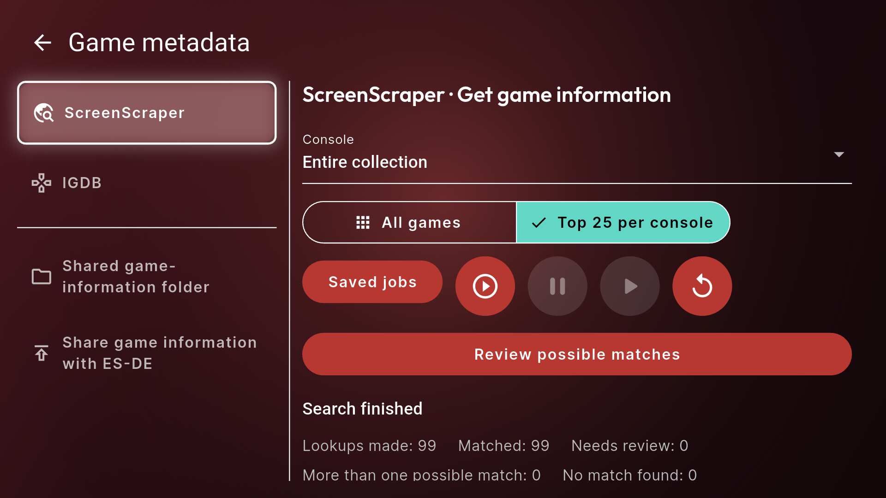

# G-Shop — cloud library, handheld first

G-Shop builds on [AverageConsumer/R-Shop](https://github.com/AverageConsumer/R-Shop) for keeping a large retro collection in Google Drive and downloading games when you want to play. Keep the controller-first frontend, add richer discovery, and spend your SD space on the games you actually use.

[Download the latest APK](https://github.com/Darkaxt/G-Shop/releases/latest) · [Add to Obtainium / ObtainX](https://apps.obtainium.imranr.dev/redirect.html?r=obtainium://add/https://github.com/Darkaxt/G-Shop) · [Upstream project](https://github.com/AverageConsumer/R-Shop)

Production package: `com.darkaxt.rshop` · APK: `app-release.apk` · Android 7.0+ · Current published release: **[1.10.0](https://github.com/Darkaxt/G-Shop/releases/tag/v1.10.0)**

  

*Real Thor capture from the signed validation work now included in public 1.9.17. Imported 3D resources come from the owner's original Socket APK and are not bundled with R-Shop.*

## What changes from the original?

The original R-Shop provides the controller-first foundation. G-Shop retains its attribution and Android update/signing identity with Google Drive as the sole collection source. Existing downloads, offline play, saves and imports remain supported; legacy source settings stay readable for recovery. Historical source comparisons below describe the upstream baseline. Version 1.10.0 is verified as an in-place Thor update, including live Drive access, cached browsing, imported 3D previews and background save dispatch.

| Area | Original workflow | Added in this fork |
| --- | --- | --- |
| Game sources | Local folders, RomM, SMB, FTP and Web | Native Google Drive sign-in and private, read-only ROM folders; download on demand without mirroring the SD card |
| Library browsing | Library-wide grid, Installed, Favorites and search | Console tabs and a dashboard with catalogue, installed/downloadable counts and storage information |
| Console navigation | Console carousel or grid | Transparent manufacturer logos, brand filtering and **Sync manufacturer** |
| Game information | Automatic artwork and metadata | Independent ScreenScraper/IGDB gathering, source-attributed ratings, cover overlays and reviewable matching |
| Discovery | Browse/search the collection | Dynamic Best 10/25/50/100 filters and independent Hack, T-Eng, Dub, Undub and Uncensor tags |
| Artwork storage | Existing cover/metadata workflow | Reconnectable shared metadata/artwork folder and optional ES-DE publication |
| Local storage | Download games for local use | Configurable retention, rotation and budgets, unified or per-console; pins and protected games |
| Saves and related files | Emulator-managed files | Opt-in Drive backups, restore/conflict handling, queued offline changes and configurable monitored save locations |
| Physical media | Flat cover presentation | Format-specific flat fallbacks, handwritten missing-art labels, optional imported 3D media and box-to-cartridge focus animation |
| Dual-screen play | Normal game launching | Per-ROM companion selection: emulator above, linked Android app below on supported devices |
| Sync feedback | Overall progress | Second current-console progress card with real game counts once the inventory is known |
| Collection organization | Console libraries | Manufacturer → home console/handheld → Commercial, Hacks and Patches, with consoles ordered by release year |
| ROM patching | Download playable content | Compatible base-game choices, local UniPatcher builds, verified-result reuse and portable content-only patch recipes |

Comparison baseline: upstream's [README](https://github.com/AverageConsumer/R-Shop/blob/d615f87277617cbf3a12a6445b3c71d42cf72539/README.md) and [source types](https://github.com/AverageConsumer/R-Shop/blob/d615f87277617cbf3a12a6445b3c71d42cf72539/lib/models/config/source.dart), reviewed on 2026-10-15. The upstream column summarizes that baseline, not an exhaustive claim about every upstream capability or future release.

## A tour on AYN Thor

Unaltered 1920 × 1080 captures from the Thor's upper display. The fresh-artwork section was captured during validation; the earlier gallery shows **1.9.1/code 15**. These features are now included in public 1.9.17. Counts and artwork reflect this collection, not bundled content or complete metadata coverage. Open an image to inspect the full-size view.

### Fresh artwork: box covers are not cartridge labels

Grid cards use box art. The selected preview uses separate cartridge, disc or UMD artwork, either flat or on locally imported 3D media. Missing labels retain the handwritten fallback; a box cover is never substituted as a cartridge texture.

  
  
  
  
  

**Top 25 per console** in the existing ScreenScraper collector takes a saved snapshot of qualifying ranked games. It does not fill gaps alphabetically, rescrape rankings to invent a sample, or download ROMs. Pause/resume and retry keep that original selection.

  

The bounded verification pass selected 24 GBA games and 25 each for N64, PS2 and PSP. Other configured consoles had no qualifying scores. It gathered 98 box covers and 96 physical labels; eight PS2 screenshots failed image validation. These are honest sample outcomes, not a claim of complete collection-wide metadata or artwork.

### Browse by manufacturer, sync only that brand

Choose Nintendo, Sony, Sega, Atari or another represented manufacturer. **All** restores the full console list; **Sync Atari**, for example, refreshes that brand's configured consoles without changing source mappings.

  
  

### A dashboard instead of an endless All Games wall

See the collection, what is installed and what can be downloaded, then enter one console. Source-library size is distinct from managed local storage; unknown sizes are not invented.

  

### Find the best-rated games in your own collection

Best 25 means up to 25 qualifying games in the selected collection/console scope, not a downloaded Top list. Rankings use the accepted overall-score policy; insufficient coverage is shown explicitly. Unrated games receive no fabricated scores, and a hack does not inherit the original game's rating. Default featured order places up to the best 100 first, followed by the rest alphabetically.

  

The example intentionally shows incomplete GBA rating coverage. Gather metadata to populate ratings and overlays; this demonstrates the controls, not a completed collection-wide scrape.

### Metadata settings with real sections

ScreenScraper, IGDB, shared storage and ES-DE sharing have separate navigation sections. Keep gathered information and artwork outside the app so they can be reconnected after reinstall; this does not back up account credentials or downloaded-game ownership records.

  
  

### Keep storage and save backups under your control

Configure cache retention and rotation globally or by console. Automatic cleanup is opt-in and applies to verified cloud-backed, managed ROMs—not arbitrary folders, saves or BIOS. Save backups use a separate private Drive area, preserve conflicts and queue offline changes for later synchronization.

  
  

The cache image shows the owner's current policy, not a requirement to enable deletion. Save monitoring requires the appropriate folder grant or configured root-access path; it is not whole-device synchronization.

## Install and set up

1. Get `app-release.apk` from this fork's [latest release](https://github.com/Darkaxt/G-Shop/releases/latest), or track `https://github.com/Darkaxt/G-Shop` in Obtainium/ObtainX.
2. Add your Google Drive source in **Settings → My Sources**. S26 supported-source removal is in progress; existing downloaded games and offline operation remain protected.
3. For Drive, authorize your account and select/map your own folders. Google OAuth application registration is required; the maintainer's private testing registration is not unrestricted public access. See [setup notes](docs/DEVELOPMENT_SETUP.md) when configuring your own clients.
4. Configure ScreenScraper/IGDB in **Settings → Game metadata** for fresh metadata and ratings. ScreenScraper needs user and authorized application credentials; IGDB needs application credentials. They are not included in the APK. Gathering metadata is separate from refreshing the game catalogue.
5. Optionally connect shared metadata/ES-DE folders, set cache policy, select save locations and link per-game companions. Root supports emulator-private locations where ordinary access is insufficient; basic library browsing does not require root.
6. Flat media previews are the default. Optionally import your own supported original **Socket Launcher 0.7 APK** in **Settings → Media previews**, then explicitly enable 3D. The cover holds until selected media is ready, then slides left over 1.5 seconds. Reduced motion skips that animation; genuinely missing artwork keeps its fallback.

Updates retain `com.darkaxt.rshop` and its production signing identity. This differs from upstream's package, so installing alongside upstream does not automatically migrate upstream's app-private data. Release assets include checksums and source/build provenance.

## Two-screen browsing and cloud media

G-Shop provides a full-width 4×2 library gallery on the main
screen and the selected game's flat/imported 3D media on the second screen.
Select a game for metadata and launch options; moving to another game restores
its preview without moving controller focus out of the gallery. Single-screen
browsing retains the existing layout. Selection, imported media, trailer sound
and real ROM launch/return have been verified on the Thor. The 1.9.17 signed
GitHub build also passed the complete actual eligible GBA ranked sample: 24 games
with separate box/cartridge artwork, playing trailers and the saved volume.

**Settings → Media previews** separates Background, Appearance, Playback and
Storage controls. Gameplay backgrounds prefer a cached clip, then screenshots,
then the red background. Drive-backed resources are organized by console/game,
with selected or visible media fetched in the background and reused locally.
The combined artwork/screenshot/trailer cache defaults to 2 GiB, adjustable in
Settings; imported Socket resources, ROMs and saves are outside that budget.
Startup uses the saved collection instead of automatically refreshing it.

Trailer sound follows **Settings → Audio → Music** (30% by default) and respects
Sound off. While the trailer plays, launcher music is muted; pausing or leaving
the preview restores the current music setting. Playback also has a trailer-sound
toggle. The second-screen window belongs only to G-Shop: launching a ROM hides
it without replacing the existing companion app.

## What is—and is not—synced

- Drive ROM sources are read-only. G-Shop does not upload ROMs or mirror the SD card into Drive.
- Games download before launch; this is not ROM streaming.
- Save/companion backups are separately configured, opt-in writes. Late uploads recheck remote conflicts instead of blindly overwriting another device.
- Removing a managed local game does not remove its cloud ROM. Cache cleanup does not authorize deleting unrelated files.
- Scores, artwork, BIOS, ROMs, provider credentials and Socket resources are not bundled.

## Move your G-Shop setup to another device

**Settings → General → Device migration** is included in 1.9.17 and remains
separate from public configuration sharing.

Choose **Backup**, set a password of at least 12 characters, then share the single
encrypted `.rshop` file. On the destination, choose **Restore**, select that file
and unlock it once. G-Shop restores its setup without asking you to re-enter each
provider's API keys. Keep the password somewhere safe: it is not recoverable from
the archive or the old device.

The archive contains source configuration, stored credentials, preferences,
favorites, emulator/save mappings, metadata/artwork, imported media, patch data,
managed downloaded games and their recorded associated data. It is a sensitive
private backup—never attach it to a public issue or commit it to a repository.
It is not a whole-device backup and does not include unrelated apps, BIOS folders
or ROMs that G-Shop does not manage.

Android may still require Google account consent, storage access or root approval;
those device permissions cannot be transferred. Missing imported saves are placed
through the normal restore path before launch. Different destination saves are
kept until you choose **Use imported** or **Keep current**; replacing a copy retains
the previous bytes. Import does not silently enable disabled monitoring or upload
unchanged imported saves.

If import is interrupted, reopen Device migration and use **Recovery → Resume**.
Startup settles the saved setup transaction before normal jobs run. **Restore
previous** recovers the preceding setup (including R-Shop backups); it does not erase games published
by migration or undo later emulator gameplay. Public config/recipe exports remain
credential-free and are not a replacement for this encrypted backup.

## Upstream heritage and documentation

Thanks to [AverageConsumer and upstream contributors](https://github.com/AverageConsumer/R-Shop) for the original frontend, controller navigation, source integrations, queue, achievements and artwork foundation. Existing upstream screenshots remain in `screenshots/`; the gallery above is specifically this fork on Thor.

[Specification](docs/SPECIFICATION.md) · [Plan](docs/IMPLEMENTATION_PLAN.md) · [Verified status](docs/IMPLEMENTATION_STATUS.md) · [Development setup](docs/DEVELOPMENT_SETUP.md) · [Upstream user guide](docs/USER_GUIDE.md) · [Contributing](CONTRIBUTING.md)

[G-Shop compatibility boundaries](docs/S26_COMPATIBILITY.md)

[Hacks, patches and portable recipes: collection layout](docs/PATCH_COLLECTION_LAYOUT.md)

G-Shop manages content you own or may legally access; it does not host or distribute games. Game artwork and brand marks belong to their respective owners. Included third-party notices remain applicable. Imported Socket resources remain local and are not redistributed in source or APK releases.

## License

The original upstream code retains its [MIT grant](LICENSE). The combined build
containing the UniPatcher engine is GPL-3.0-or-later, with Darkaxt integration
credit and preserved [third-party notices](assets/patch_engine_licenses/NOTICE.txt).
Corresponding patch-engine source is included under `android/patch-engine`.
